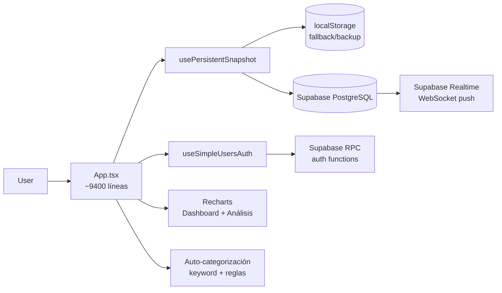

# FinPilot · Control Financiero Personal

**FinPilot** es una aplicación web progresiva (PWA) para gestión financiera personal, construida con React 19 + TypeScript 6 y Supabase como backend. Permite organizar el dinero en **bolsillos virtuales**, registrar **ingresos y gastos con categorización inteligente**, programar **obligaciones recurrentes**, hacer **seguimiento de deudas**, crear **provisiones de ahorro** y definir **metas financieras** — todo sincronizado en tiempo real entre dispositivos vía WebSocket.

---

## Stack tecnológico

| Capa | Tecnología | Versión |
|------|-----------|---------|
| **Frontend** | React + TypeScript | 19 / 6.0 |
| **Build** | Vite | 8.x |
| **Charts** | Recharts | 3.8 |
| **Íconos** | react-icons (Lucide) | 5.6 |
| **Backend** | Supabase (PostgreSQL 16) | — |
| **Sync** | Supabase Realtime (WebSocket) | — |
| **Auth** | Custom simple-users (RPC + session tokens) | — |
| **Hosting** | Firebase Hosting (PWA) | — |
| **Estilos** | CSS custom properties (dark theme) | — |

**Por qué este stack y no otro.** Supabase reemplaza un backend tradicional completo: base de datos, API REST, autenticación y WebSocket en un solo servicio. Firebase Hosting da deploy con un comando y soporte PWA nativo. No hay framework CSS porque la app prioriza rendimiento mobile y el tema oscuro se maneja con variables CSS sin overhead de librerías.

---

## Estado del proyecto

| Módulo | Estado |
|--------|--------|
| Bolsillos (gestión de cuentas) | ✅ Estable |
| Gastos con categorización inteligente | ✅ Estable |
| Ingresos recurrentes / únicos | ✅ Estable |
| Transferencias entre bolsillos | ✅ Estable |
| Obligaciones fijas (programadas) | ✅ Estable |
| Deudas con cuotas | ✅ Estable |
| Provisiones de ahorro mensual | ✅ Estable |
| Metas financieras (término fijo / indefinido) | ✅ Estable |
| Dashboard con KPIs y análisis | ✅ Estable |
| Supabase Realtime (multi-dispositivo) | ✅ Estable |
| Autenticación simple por usuario | ✅ Estable |
| Impuesto 4x1000 automático | ✅ Estable |
| Selector de íconos Lucide | ✅ Estable |
| Administración de usuarios (admin) | ✅ Estable |
| Push a GitHub | ⏳ Pendiente |

---

## El problema y por qué existe

La app nace de una necesidad real: **llevar las finanzas personales sin depender de una hoja de cálculo, sin apps que venden tus datos, y sin suscripciones mensuales.**

El modelo mental es simple — el dinero se distribuye en **bolsillos** con propósitos específicos (operación diaria, ahorro, pagos fijos, inversiones). Cada ingreso cae en un bolsillo, cada gasto sale de uno. Las transferencias mueven dinero entre ellos. No hay cuentas de "debe/haber" contables, solo una representación visual de dónde está y hacia dónde va tu plata.

Tres decisiones clave:

**Primero, la categorización de gastos es auto-aprendida.** No necesitas etiquetar cada gasto manualmente. La app aprende de tus patrones: si varias veces escribiste "uber" y lo moviste a "Transporte", la próxima vez que escribas "uber" lo sugiere solo. Las reglas de aprendizaje (`LearningRule`) se acumulan y mejoran con el uso.

**Segundo, los datos son tuyos.** No hay servers propietarios intermediarios. Tus datos viven en tu proyecto de Supabase (o en localStorage si no configuras Supabase). Si mañana quieres migrar, los datos están en PostgreSQL y puedes exportarlos con una query.

**Tercero, el soporte multi-dispositivo es real.** Supabase Realtime sincroniza cambios entre dispositivos por WebSocket en milisegundos. Agregas un gasto en el celular y aparece en la tablet sin recargar.

---

## Arquitectura

```
                         ┌─────────────────────────────────────┐
                         │       Firebase Hosting (CDN)         │
                         │    ┌───────────────────────────┐     │
                         │    │   PWA · manifest + SW     │     │
                         │    └──────────┬────────────────┘     │
                         └───────────────┼─────────────────────┘
                                         │
                                         ▼
                         ┌─────────────────────────────────────┐
                         │     FinPilot App (React 19 SPA)      │
                         │                                      │
                         │  ┌─────────────────────────────────┐ │
                         │  │  usePersistentSnapshot (state)   │ │
                         │  │  ┌──────────┐  ┌──────────────┐ │ │
                         │  │  │localState│  │remoteSnapshot│ │ │
                         │  │  │(fallback)│  │ (Supabase)   │ │ │
                         │  │  └──────────┘  └──────┬───────┘ │ │
                         │  └───────────────────────┼─────────┘ │
                         │                          │           │
                         │  ┌──────────────────────┐│           │
                         │  │  useSimpleUsersAuth   ││           │
                         │  │  (RPC auth + session) ││           │
                         │  └──────────────────────┘│           │
                         │                          ▼           │
                         │  ┌──────────────────────────────────┐ │
                         │  │  App.tsx (~9400 líneas, 9 views) │ │
                         │  │                                  │ │
                         │  │  Resumen · Bolsillos · Movs     │ │
                         │  │  Programación · Deudas · Provs  │ │
                         │  │  Metas · Análisis · Config      │ │
                         │  └──────────────────────────────────┘ │
                         └──────────────────┬──────────────────┘
                                            │
                ┌───────────────────────────┼───────────────────────┐
                │                           │                       │
                ▼                           ▼                       ▼
   ┌────────────────────────┐  ┌────────────────────────┐  ┌───────────────────────┐
   │   Supabase PostgreSQL  │  │   Supabase Realtime    │  │   localStorage        │
   │                        │  │   (WebSocket channel)  │  │   (fallback offline)  │
   │   14 tablas relacional │  │   sync instantáneo     │  │                       │
   │   + RPC auth + RLS     │  │   entre dispositivos   │  │   JSON envelope       │
   │   + publicación Realtime│  │                        │  │   + backup rotativo   │
   └────────────────────────┘  └────────────────────────┘  └───────────────────────┘
```

### Flujo de datos



### Protecciones contra pérdida de datos

El sync pasó por un refactor importante para eliminar un riesgo crítico: cuando el state local se corrompía, el save() borraba todo en Supabase antes de re-subir.

| Mecanismo | Cómo funciona |
|-----------|--------------|
| **Pending deletes explícitos** | Nunca se borra por diferencia. La UI llama `markEntityForRemoteDelete()` solo cuando el usuario hace clic en eliminar. |
| **Guarda de borrado masivo** | Si un sync intenta borrar >50% de los registros de una tabla, se bloquea con error. |
| **Snapshot rotativo** | Los últimos 5 saves exitosos quedan respaldados en localStorage como JSON (`finpilot-backup-{userId}`). |
| **Preservación de nombres custom** | Si el state local se resetea a valores por defecto (Operacion, Colchon...), la BD conserva los nombres reales del usuario. |

---

## Views y módulos

La app tiene **9 vistas** accesibles desde el sidebar, y **6 módulos** de composer para crear/editar.

### Vistas

| Vista | Descripción |
|-------|-------------|
| **Resumen** | Dashboard con KPIs: presupuesto diario disponible, ritmo del mes, runway financiero, cobertura de fondo de emergencia, comparativo mes vs mes, tasa de ahorro histórica |
| **Bolsillos** | CRUD de bolsillos con íconos Lucide (selector popover con búsqueda y agrupación), colores personalizados, toggle 4x1000 |
| **Movimientos** | Feed filtrable por bolsillo/tipo/fecha, agrupado por día o mes |
| **Programación** | Obligaciones fijas recurrentes (arriendo, servicios, suscripciones) con día de pago y confirmación |
| **Deudas** | Seguimiento de deudas con cuotas, pagos programados y extra, cálculo de meses restantes |
| **Provisiones** | Compromisos de ahorro mensual hacia un bolsillo, con seguimiento de cumplimiento |
| **Metas** | Objetivos de ahorro a término fijo o indefinido, con progreso, ritmo diario, cuota mensual sugerida, "¿vas bien?" |
| **Análisis** | Charts: evolución mensual, gastos por categoría (donut), por bolsillo, por día de semana, escenarios pesimista/realista/optimista, deuda vs ingreso |
| **Configuración** | Gestión de categorías, configuración de bolsillos, administración de usuarios (admin) |

### Módulos (composer)

| Módulo | Acción |
|--------|--------|
| Gasto | Registrar salida con descripción, categoría sugerida automáticamente (reglas de aprendizaje), hora |
| Ingreso | Distribuir entrada a un bolsillo, opción recurrente |
| Transferencia | Mover dinero entre bolsillos, nota opcional |
| Fijos | Crear obligación programada (día de pago, día de confirmación) |
| Bolsillos | Crear bolsillo con nombre, tipo, color, ícono |

---

## Estructura del repositorio

```
.
├── index.html                          ← Entry point PWA (meta tags, manifest, cache busting)
├── vite.config.ts                      ← Vite config + React plugin
├── tsconfig.json / tsconfig.app.json   ← TypeScript config (strict mode)
├── package.json                        ← Dependencies + scripts
├── .env.example                        ← Variables de entorno requeridas
├── firebase.json                       ← Firebase Hosting config (+ rewrites SPA, headers PWA)
├── eslint.config.js                    ← ESLint flat config
│
├── src/
│   ├── main.tsx                        ← Entry point (iOS Safari zoom prevention)
│   ├── index.css                       ← CSS custom properties (dark theme, variables globales)
│   ├── App.tsx                         ← ~9400 líneas — toda la app en un solo componente
│   ├── App.css                         ← ~8200 líneas — estilos de toda la UI
│   │
│   ├── components/
│   │   └── FullscreenComposer.tsx      ← Modal/compositor a pantalla completa
│   │
│   ├── domain/
│   │   ├── finance/
│   │   │   ├── types.ts                ← Tipos: Pocket, Expense, Income, Debt, Goal, etc.
│   │   │   └── constants.ts            ← Íconos emoji legacy, categories, keywords, initialState
│   │   └── pocketIcons.tsx             ← Catálogo Lucide SVG para selector de íconos
│   │
│   ├── hooks/
│   │   ├── usePersistentSnapshot.ts    ← Corazón del state: localStorage ↔ Supabase sync
│   │   ├── useSimpleUsersAuth.ts       ← Auth con Supabase RPC (iniciar/registrar/cerrar sesión)
│   │   └── useSupabaseAuth.ts          ← Auth wrapper adicional
│   │
│   ├── services/
│   │   ├── supabaseClient.ts           ← Cliente Supabase singleton + session token
│   │   ├── supabaseFinance.ts          ← Driver completo: load/save 14 tablas, pending deletes, guards
│   │   ├── supabaseSnapshot.ts         ← Helper de snapshot remoto
│   │   └── persistence.ts              ← Capa de persistencia genérica (local + remote driver)
│   │
│   └── assets/
│       ├── hero.png
│       ├── react.svg
│       └── vite.svg
│
├── supabase/
│   ├── schema.sql                      ← Schema completo + RPC auth + RLS policies + Realtime publication
│   ├── updates/
│   │   ├── 2026-04-17_add_hora_movimientos.sql
│   │   ├── 2026-05-05_add_provisiones.sql
│   │   ├── 2026-05-19_add_metas.sql
│   │   ├── 2026-05-19_enable_realtime.sql
│   │   ├── 2026-05-20_add_4x1000_to_bolsillos.sql
│   │   └── 2026-05-21_add_parent_to_gastos.sql
│   └── insertprueba.sql                ← Datos de prueba
│
├── public/
│   ├── manifest.webmanifest            ← PWA manifest (standalone mode, icons)
│   ├── app-icon-180-v2.png
│   ├── app-icon-192-v2.png
│   └── app-icon-512-v2.png
│
└── dist/                               ← Build output (gitignored)
```

---

## Schema de base de datos

14 tablas relacionales en Supabase PostgreSQL, todas con RLS (Row Level Security) por `usuario_id`:

| Tabla | Propósito |
|-------|-----------|
| `usuarios` | Usuarios con username, cédula, password plano, typeuser (admin/user) |
| `sesiones` | Session tokens con hash SHA-256, expiración a 30 días |
| `configuracion` | Preferencias por usuario (etiquetas de tipos de bolsillo) |
| `categorias` | Categorías de gasto (Hogar, Comida, Transporte...) |
| `reglas_aprendizaje` | Reglas de auto-categorización (keyword → categoría + aciertos) |
| `bolsillos` | Bolsillos con tipo (daily/savings/fixed/invest), color, ícono, toggle 4x1000 |
| `obligaciones` | Gastos fijos programados (día de pago + confirmación) |
| `ingresos` | Ingresos con fecha, hora, bolsillo destino, recurrente |
| `deudas` | Deudas con monto total, pendiente, cuota, estado |
| `gastos` | Gastos con origen, confianza, categoría, referencia a padre 4x1000 |
| `transferencias` | Transferencias entre bolsillos con nota |
| `pagos_obligaciones` | Historial de pagos de gastos fijos |
| `pagos_deudas` | Historial de pagos de deudas (scheduled/extra) |
| `cierres_mensuales` | Snapshots mensuales de ingresos, gastos, flujo neto |
| `provisiones` | Compromisos de ahorro mensual |
| `metas` | Objetivos de ahorro (término fijo o indefinido) |

**Vistas**: `movimientos` — unifica gastos, ingresos y transferencias en una sola vista con `security_invoker = true`.

**Auth**: Todo el sistema de autenticación corre sobre RPC de Supabase:
- `iniciar_sesion_simple(p_username, p_password)` → genera token, devuelve sesión
- `registrar_usuario_simple(...)` → crea usuario + configuración + sesión
- `usuario_actual_simple()` → valida token actual
- `cerrar_sesion_simple()` → revoca token

**Publicación Realtime**: 14 tablas habilitadas para `supabase_realtime` con `replica identity full` para propagación instantánea entre dispositivos.

---

## Instalación local

### Prerrequisitos

| Software | Versión | Cómo obtenerlo |
|----------|---------|----------------|
| Node.js | 20.x+ | `brew install node@20` |
| npm | 10.x+ | incluido con Node |
| Supabase account | — | [supabase.com](https://supabase.com) — plan free tier |

### 1. Clonar e instalar

```bash
git clone <repo-url>
cd personalApp
npm install
```

### 2. Configurar variables de entorno

```bash
cp .env.example .env
```

Editar `.env`:

```env
VITE_SUPABASE_URL=https://tu-proyecto.supabase.co
VITE_SUPABASE_ANON_KEY=tu-anon-key
VITE_SUPABASE_PUBLISHABLE_KEY=tu-publishable-key
VITE_SUPABASE_PROFILE_ID=admin-root
VITE_SUPABASE_FINANCE_TABLE=finance_snapshots
```

### 3. Aplicar schema

Abrir el SQL Editor de Supabase y pegar el contenido de `supabase/schema.sql` completo. Ejecutar.

### 4. Correr en desarrollo

```bash
npm run dev
# → http://localhost:5173
```

### 5. Build de producción

```bash
npm run build
npm run preview
# → http://localhost:4173
```

---

## Deploy

```bash
# Firebase Hosting
npm run deploy
# → despliega a Firebase Hosting con rewrites SPA

# Preview en canal temporal
npm run deploy:preview
# → Firebase Hosting Channel: preview URL
```

---

## Cómo navegar este repo

| Vengo a... | Empiezo por |
|-----------|-------------|
| Entender el modelo de datos | `supabase/schema.sql` (753 líneas) |
| Ver los tipos de dominio | `src/domain/finance/types.ts` |
| Ver el estado inicial y constantes | `src/domain/finance/constants.ts` |
| Entender cómo persiste el state | `src/hooks/usePersistentSnapshot.ts` + `src/services/persistence.ts` |
| Ver cómo se sincroniza con Supabase | `src/services/supabaseFinance.ts` (1040 líneas) |
| Ver todo el frontend de una | `src/App.tsx` (~9400 líneas en un componente) |
| Ver la lógica de auth | `src/hooks/useSimpleUsersAuth.ts` |
| Ver el catálogo de íconos | `src/domain/pocketIcons.tsx` |
| Ver migraciones de BD | `supabase/updates/*.sql` |
| Ver config de PWA | `public/manifest.webmanifest`, `index.html`, `firebase.json` |

---

## Decisiones técnicas

**D-01 — Un solo componente App.tsx (~9400 líneas).** No es bonito, pero es deliberado. La app empezó como un experimento personal y la velocidad de iteración era más importante que la división en componentes. Toda la lógica de UI, estado, formularios, gráficas y routing vive en un archivo. Para una V2, lo primero que habría que hacer es extraer vistas en archivos separados. Pero funciona, los memos están optimizados, y los re-renders no son un problema.

**D-02 — Auto-categorización por reglas de aprendizaje.** En lugar de usar un modelo de ML externo o una API de clasificación, la app aprende de las decisiones del usuario. Cada vez que mueves un gasto de una categoría sugerida a otra, se crea/refuerza una regla (`LearningRule`). Con el tiempo, las reglas acumulan `hits` y el scoring pondera más las reglas con más aciertos. Simple, offline, sin costo.

**D-03 — Impuesto 4x1000 automático.** Colombia tiene un impuesto del 0.4% (4 por mil) sobre transacciones financieras. Los bolsillos pueden tener el flag `taxes4x1000` activado, y cada vez que haces un gasto o transferencia desde ese bolsillo, se genera automáticamente un gasto adicional de categoría "Impuestos" con referencia al movimiento padre. Esto permite tener visibilidad real del costo financiero.

**D-04 — Sync no destructivo con pending deletes.** El sync original usaba borrado por diferencia: si el state local tenía 3 gastos y la BD 10, borraba 7. Esto era eficiente pero peligroso. El refactor cambió a un modelo donde solo se borra lo que el usuario explícitamente eliminó (`markEntityForRemoteDelete`). Además hay un guarda que bloquea borrados masivos >50%.

**D-05 — Auth simple sobre Supabase RPC.** En lugar de usar Supabase Auth (que requiere email/phone/OAuth), la app implementa su propio sistema de autenticación con tabla `usuarios`, passwords en texto plano, y session tokens con hash SHA-256 almacenados en localStorage. Es intencionalmente simple para un uso personal/familiar sin depender de proveedores externos.

**D-06 — PWA con iOS Safari soportado.** La app tiene mitigaciones específicas para iOS Safari: prevención de zoom con gestos (gesturestart/gesturechange), prevención de doble tap zoom, meta tags `apple-mobile-web-app-capable`, `viewport-fit=cover` para el notch, y un webmanifest que permite agregar la app a la pantalla de inicio.

---

## Riesgos conocidos y mitigaciones

| Riesgo | Impacto | Mitigación |
|--------|---------|------------|
| Password en texto plano en BD | Medio | Sistema diseñado para uso personal/familiar con confianza implícita. No expuesto a internet público sin capa adicional |
| App.tsx monolítico (~9400 líneas) | Medio (mantenibilidad) | Refactor planeado para V2: extraer vistas en archivos separados |
| Sin tests automatizados | Alto | La app es personal y el costo de tests no se justifica para el uso actual. Priorizar si crece la base de usuarios |
| Sin CI/CD pipeline | Bajo | Deploy manual con `npm run deploy`. Firebase Hosting permite rollback desde la consola |
| Sin manejo de errores unificado | Medio | Los errores de sync se manejan con un hook de notificación en UI (`showUiNotice`). No hay error boundaries de React |
| Dependencia única de Supabase | Medio | Si Supabase se cae, la app opera en modo local-only con localStorage. Los datos no se pierden |

---

## Lo que falta / Roadmap

```
✅ Bolsillos, gastos, ingresos, transferencias, obligaciones
✅ Deudas, provisiones, metas
✅ Dashboard con KPIs y análisis
✅ Supabase Realtime multi-dispositivo
✅ Auth simple con sesiones
✅ 4x1000 automático
✅ Selector de íconos Lucide
✅ PWA + iOS Safari soporte
✅ Admin de usuarios
✅ Guardas anti pérdida de datos (pending deletes, >50% block, backup)
─────────────────────────────────────────────────────────────
⬜ Tests automatizados (vitest)
⬜ Refactor App.tsx en vistas separadas (react-router opcional)
⬜ CI/CD con GitHub Actions
⬜ Manejo de errores con Error Boundaries
⬜ Modo offline estricto (Service Worker)
⬜ Exportar datos a CSV
⬜ Presupuesto mensual por categoría
⬜ Notificaciones push de pagos próximos
```

---

## Scripts disponibles

```bash
npm run dev           # Desarrollo con HMR
npm run build         # Build de producción (tsc + vite)
npm run preview       # Preview del build local
npm run lint          # ESLint
npm run deploy        # Build + Firebase Hosting deploy
npm run deploy:preview  # Preview channel deploy
```

---

## Variables de entorno

| Variable | Obligatoria | Descripción |
|----------|-------------|-------------|
| `VITE_SUPABASE_URL` | Sí | URL del proyecto Supabase |
| `VITE_SUPABASE_ANON_KEY` | Sí | Anon key pública de Supabase |
| `VITE_SUPABASE_PUBLISHABLE_KEY` | No | Alias alternativo para la anon key |
| `VITE_SUPABASE_PROFILE_ID` | Sí | ID del perfil admin raíz |
| `VITE_SUPABASE_FINANCE_TABLE` | Sí | Nombre de tabla para snapshots |

---

## Créditos

App personal desarrollada por **Javier Portilla Rosero**. Construida con React, TypeScript, Supabase y mucho café.
